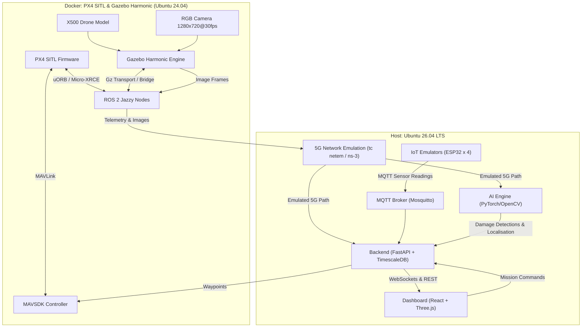

# INFYNEX Architecture Specification

## 1. System Overview
INFYNEX is structured around loose coupling with clear communication contracts. Each component can run independently or within the integrated pipeline.

## 2. Module Specifications

### 2.1 Module A: Drone and Flight Control
- **Model**: Standard quadcopter X500.
- **Flight Modes**: Offboard position control, Takeoff, Hover, Waypoint navigation, RTL (Return to Launch), Land.
- **Sensor Feeds**:
  - Vehicle odometry (`/fmu/out/vehicle_odometry` -> `/infynex/drone/position`)
  - Battery state (`/fmu/out/battery_status` -> `/infynex/drone/battery`)
  - Mission status (`/infynex/drone/mission_status`)
- **Camera Sensor**:
  - Resolution: 1280x720 @ 30 FPS
  - FOV: 80 degrees horizontal
  - Image transport: raw RGB8 published via ROS 2 topic `/infynex/camera/image_raw`.

### 2.2 Module B: 3D Infrastructure Environment
- Realistic concrete bridge/facade structure with walls, pillars, crossbeams, foundation, and obstacles.
- Visible damage elements:
  - Vertical, horizontal, and diagonal cracks.
  - Surface spalling (exposed rough aggregate / missing concrete).
- Ground truth annotations exported with precise world coordinates, surface normal, and bounding box / mask specifications.

### 2.3 Module C: AI Damage Detection & Localisation
- Detection of structural defects: Cracks and Spalling.
- Bounding box inference + segmentation confidence scores.
- Localisation engine: Maps 2D image coordinates to 3D surface coordinates using drone pose, camera intrinsics/extrinsics, and ray-casting against the structure geometry.

### 2.4 Module D: IoT Sensor Node Simulation
- Software-emulated ESP32 microcontrollers:
  - Node 1: DS18B20 (Concrete surface temperature)
  - Node 2: DS18B20 (Internal structural temperature)
  - Node 3: BME280 (Ambient temperature, relative humidity, barometric pressure)
  - Node 4: DHT22 (Ambient temperature and humidity)
- Environmental perturbation engine and fault injection (dropouts, noise, abnormal spikes).
- MQTT transport over topic hierarchy `infynex/sensors/{node_id}/{sensor_type}`.

### 2.5 Module E: 5G Network Simulation
- Dual-tier simulation:
  1. Radio simulation in ns-3 with 5G-LENA (calculating CQI, MCS, SINR, RSRP, transport block sizes, and radio latency).
  2. Integrated application-level emulation using Linux `tc netem` applying dynamic latency, jitter, loss, and rate limiting to real simulation data streams.

### 2.6 Module F: Edge Backend & Monitoring Dashboard
- FastAPI asynchronous backend providing:
  - Telemetry & frame ingestion pipelines.
  - TimescaleDB time-series storage for sensor and network metrics.
  - WebSocket broadcaster for sub-50ms dashboard telemetry updates.
- Modern dark SaaS dashboard built in React + TypeScript + Three.js featuring 3D digital twin visualization, real-time damage mapping, and automated PDF report compilation.
